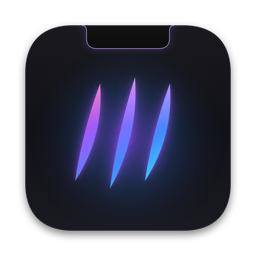
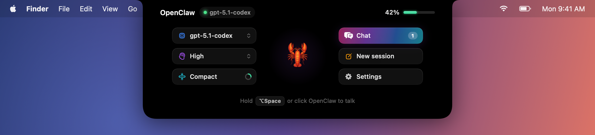
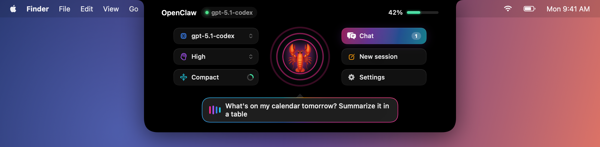
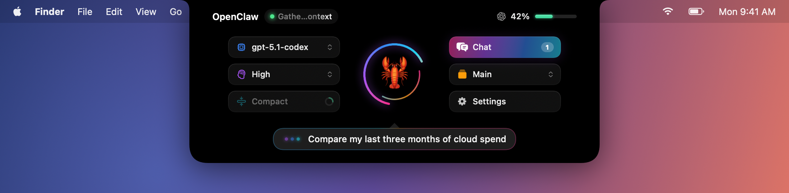
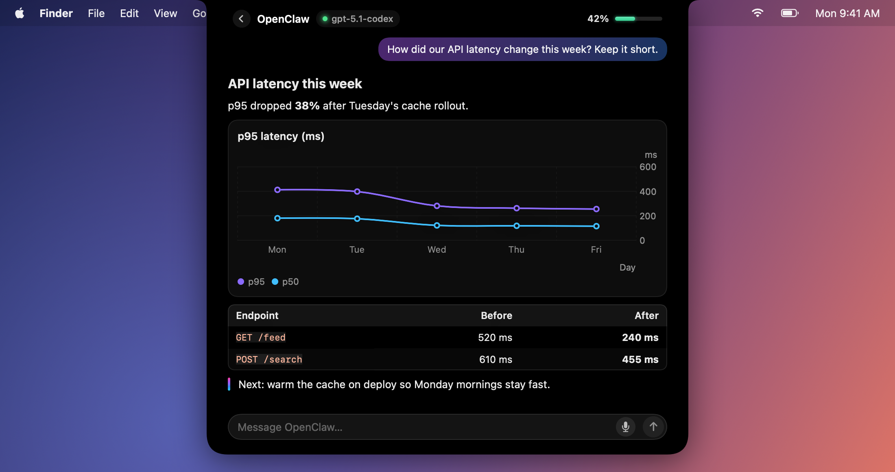
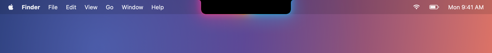

<p align="center">
  
</p>

<h1 align="center">NotchClaw</h1>

<p align="center">
  
  
  
  
  
</p>

<p align="center">
  <b>Talk to your <a href="https://github.com/openclaw/openclaw">OpenClaw</a> agent from the MacBook notch.</b><br>
  Hover to open, hold a key to speak, and watch replies stream in as rich Markdown, charts, and images.
</p>

<p align="center">
  
</p>

## Table of contents

- [Features](#features)
- [Requirements](#requirements)
- [Install](#install)
- [Set up](#set-up)
- [Use case](#use-case)
- [Charts and images in replies](#charts-and-images-in-replies)
- [Acknowledgments](#acknowledgments)
- [License](#license)

> How it works, privacy and security, development, and troubleshooting live in [CONTRIBUTING.md](CONTRIBUTING.md).

## Features

### Hold to talk and control with your voice

<table>
  <tr>
    <td width="50%"></td>
    <td width="50%"></td>
  </tr>
  <tr>
    <td align="center"><sub>Hold <kbd>⌥ Space</kbd> to speak. Your words appear live.</sub></td>
    <td align="center"><sub>The agent's rings orbit while it thinks.</sub></td>
  </tr>
</table>

- Hold <kbd>⌥ Space</kbd> anywhere: the notch opens,  your words are transcribed live in a speech bubble. Release to send.

- Say "set effort to high", "switch model to sonnet", "compact the context", "new session", or "stop".

### Rich replies

<p align="center">
  <br>
  <sub>Replies land in the chat screen as Markdown, tables, and native charts.</sub>
</p>

### Sleek design

<p align="center">
  <br>
  <sub>Minimized, the notch glows when there's something new.</sub>
</p>


- If your agent uses a ChatGPT/Codex login, the header shows your 5-hour, daily, or weekly usage (Can be set in the settings).

### Performance

- It reconnects in under a second when Wi‑Fi returns or the Mac wakes, and shows a calm offline state in between.

- Swift, SwiftUI, and AppKit with zero third-party dependencies, at about 2 MB.

---

## Requirements

- Apple Silicon
- MacOS 14 Sonoma or later
- A running **OpenClaw gateway** (protocol v4, OpenClaw 2026.8 or newer)

## Install

1. Download the latest `NotchClaw-x.y.z.dmg` from [**Releases**](https://github.com/sjcsoftware/notchclaw/releases).
2. Open it and drag **NotchClaw** into **Applications**.
3. Launch it from applications.

### Build from source

You need the Xcode **Command Line Tools**.

```bash
git clone https://github.com/sjcsoftware/notchclaw.git
cd notchclaw
scripts/build.sh        # → dist/NotchClaw.app and dist/NotchClaw-<version>.dmg
open dist/NotchClaw.app
```

## Set up

NotchClaw opens **Settings** on first launch. You can reopen it any time with <kbd>⌘ ,</kbd>, from the gear on the notch, or from the menu bar icon.

> The setup is the same as setting up any new machine on your OpenClaw gateway.

1. **Gateway URL**
2. **Token**
3. **Session** - Leave this as `main` to talk to your agent's main session, or enter any session key.
4. Click **Save & Connect**

- **Remote gateways need a one-time approval**

  NotchClaw signs in with its own device identity, so the gateway asks you to approve it. The notch shows the exact command; run it on the gateway host:

  ```bash
  openclaw devices list
  openclaw devices approve <requestId>
  ```

  NotchClaw connects by itself once you approve it. Connections from the same machine (loopback) are approved automatically.

- **Voice permissions**
  
  The first time you hold the shortcut, macOS asks for **Microphone** and **Speech Recognition** access. Allow both, then hold the shortcut again.

## Use case

| Do this | To |
| --- | --- |
| Hover over the notch | Open the default screen (agent, controls, usage) |
| Hold <kbd>⌥ Space</kbd> (or click the agent) | Talk; release to send |
| Click **Chat** | Open the conversation and type (<kbd>↩</kbd> sends, <kbd>⌥ ↩</kbd> adds a new line) |
| Click the model name or **Model** | Switch models (from the gateway's catalog) |
| **Effort** | Set reasoning effort (off → xhigh) |
| **Compact** | Summarize old context; the ring shows how full the context window is |
| **New session** | Reset the session |
| Click the usage meter | Choose the 5h, daily, or weekly Codex window |
| <kbd>Esc</kbd> in chat | Clear the draft, or go back home |
| Move the pointer away or click elsewhere | Minimize (the 📌 pin in chat keeps it open) |

**Voice commands.** Short phrases are treated as controls instead of messages:

| Say | Effect |
| --- | --- |
| "set effort to high", "thinking max" | Reasoning effort |
| "switch model to sonnet", "use gpt five codex model" | Model (fuzzy-matched) |
| "compact the context" | Compaction |
| "new session", "start over" | Reset |
| "stop" | Abort the current reply |

Everything else is sent to your agent.

## Charts and images in replies

**Charts need no setup.** Each message sent from NotchClaw carries a short formatting note asking the agent to reply in Markdown. When numbers help, the note also asks for a fenced `chart` block, which NotchClaw draws with Swift Charts:

````markdown
```chart
{"type": "bar", "title": "Weekly signups", "x": "Week", "y": "Signups",
 "data": [{"x": "W1", "y": 120}, {"x": "W2", "y": 180}, {"x": "W3", "y": 240, "series": "optional"}]}
```
````

Supported types are `bar`, `line`, `area`, `point`, and `pie`. Add `series` for multiple lines or bars. If the JSON is malformed, the block is shown as code. You can turn the note off in **Settings › Agent**.

**Images use OpenClaw's `image_generate` tool.** It's available whenever an image provider is configured. If your agent signs in with **ChatGPT/Codex OAuth**, `openai/gpt-image-2` already works with no extra keys. Otherwise, set an `OPENAI_API_KEY` (or a Gemini or OpenRouter key) and optionally pick a default model:

```json5
// ~/.openclaw/openclaw.json
{ agents: { defaults: { mediaModels: { image: { primary: "openai/gpt-image-2" } } } } }
```

Generated images appear inline in the chat. Click one to open it in Preview, or right-click to copy or save it.

> **Where do standing instructions go?** In OpenClaw, `MEMORY.md` is for durable facts and decisions, not behaviour. If you want charts and images on every channel (Telegram, WhatsApp, and so on), add a line to your workspace's **`AGENTS.md`** instead, for example: *"When data is easier to grasp visually, include a chart; when a picture would help, use image_generate."* Inside NotchClaw you don't need this, because the per-message note already covers it.

## Acknowledgments

- [OpenClaw](https://github.com/openclaw/openclaw), the personal agent and gateway this app drives.
- [boring.notch](https://github.com/TheBoredTeam/boring.notch), whose notch window and shape techniques inspired NotchClaw.

## License

Copyright © 2026 chaseungjoon.

NotchClaw is free software: you can redistribute it and/or modify it under the terms of the
[GNU General Public License v3.0](LICENSE) as published by the Free Software Foundation, either
version 3 of the License, or (at your option) any later version. It is distributed in the hope that it
will be useful, but WITHOUT ANY WARRANTY; see the license for details.
